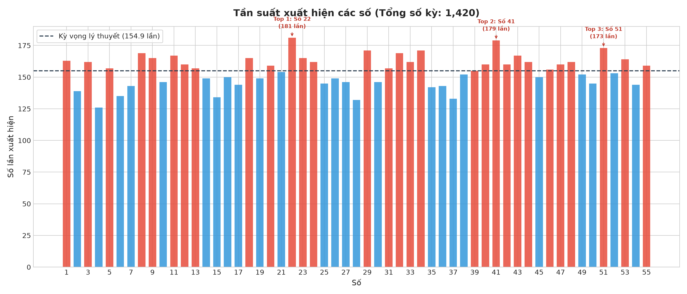
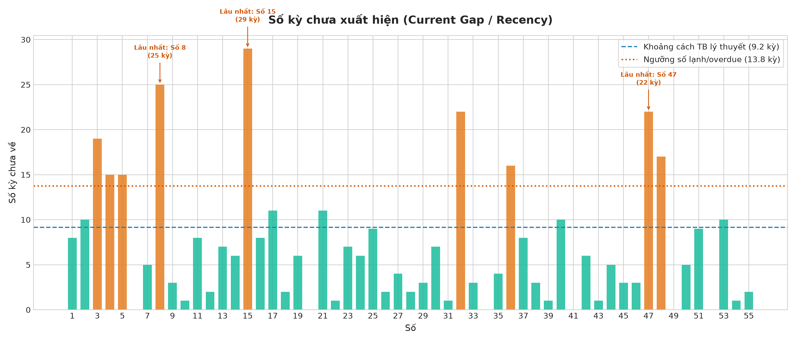
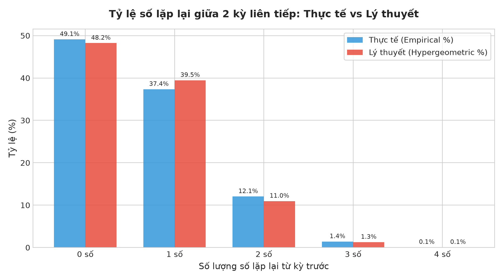
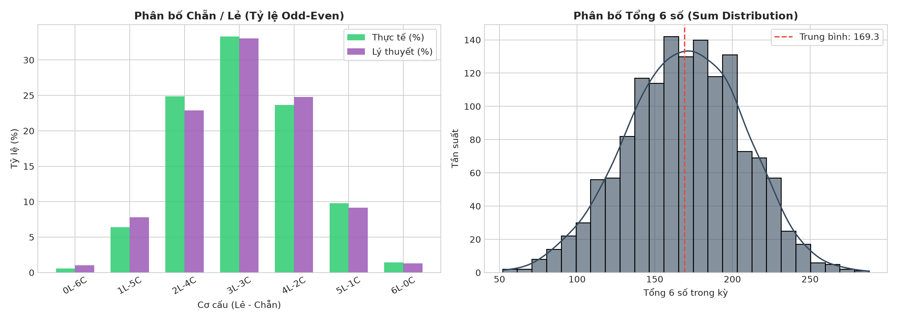
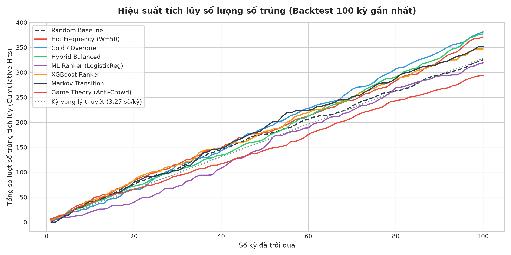
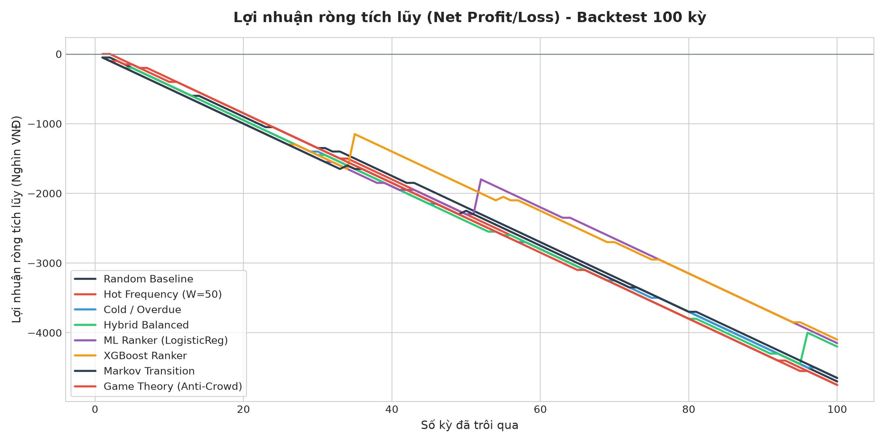

# BÁO CÁO PHÂN TÍCH DỮ LIỆU & THỬ NGHIỆM MÔ HÌNH DỰ ĐOÁN VIETLOTT
**Sản phẩm phân tích**: Vietlott Power 6/55 (POWER655)  
**Thời gian xuất báo cáo**: 2026-11-07 09:21:14  
**Dữ liệu lịch sử**: 1,420 kỳ quay (2017-08-01 đến 2026-11-05)  
**Nguồn dữ liệu**: [vietvudanh/vietlott-data](https://github.com/vietvudanh/vietlott-data)  

> **Tuyên bố miễn trừ trách nhiệm (Disclaimer)**: Xổ số là trò chơi xác suất ngẫu nhiên hoàn toàn độc lập giữa các kỳ quay. Báo cáo này được thực hiện phục vụ nghiên cứu khoa học dữ liệu (Data Science & Backtesting), không cam kết bất kỳ khả năng làm giàu hay trúng thưởng nào và không khuyến khích cờ bạc dưới mọi hình thức.

---
## 1. TỔNG QUAN DỮ LIỆU & THỐNG KÊ MÔ TẢ
- **Tổng số kỳ quay hợp lệ**: 1,420
- **Phạm vi ngày**: 2017-08-01 đến 2026-11-05
- **Tổng số bóng**: 1 đến 55
- **Số bóng rút mỗi kỳ**: 6 số chính + 1 số đặc biệt
- **Kỳ vọng xuất hiện lý thuyết của mỗi số**: Mỗi kỳ có xác suất $p = 6/55 = 0.1091$, tương đương trung bình xuất hiện một lần sau mỗi $9.17$ kỳ.
- **Tổng 6 số trung bình**: 169.29 (Kỳ vọng lý thuyết: 168.0, Độ lệch chuẩn: 37.4, Min: 52, Max: 288)

### 1.1. Top Số Nóng (Hot Numbers) & Số Lạnh (Cold Numbers)
*Được xác định dựa trên cửa sổ 50 kỳ gần nhất:*

| Phân loại | Số | Số lần xuất hiện | Tỷ lệ (%) | Số kỳ chưa về hiện tại |
| :--- | :---: | :---: | :---: | :---: |
| **HOT** | `18` | 11 | 22.0% | 2 kỳ |
| **HOT** | `27` | 10 | 20.0% | 4 kỳ |
| **HOT** | `07` | 10 | 20.0% | 5 kỳ |
| **HOT** | `11` | 10 | 20.0% | 8 kỳ |
| **HOT** | `45` | 9 | 18.0% | 3 kỳ |
| **COLD** | `15` | 2 | 4.0% | 29 kỳ |
| **COLD** | `32` | 3 | 6.0% | 22 kỳ |
| **COLD** | `36` | 3 | 6.0% | 16 kỳ |
| **COLD** | `04` | 3 | 6.0% | 15 kỳ |
| **COLD** | `17` | 3 | 6.0% | 11 kỳ |

### 1.2. Top Số Lâu Chưa Xuất Hiện Nhất (Overdue Gaps)
| Số | Số kỳ chưa về hiện tại (Current Gap) | Kỷ lục vắng mặt dài nhất (Max Gap) | Khoảng cách TB lịch sử (Mean Gap) |
| :---: | :---: | :---: | :---: |
| `15` | **29** kỳ | 43 kỳ | 10.39 kỳ |
| `08` | **25** kỳ | 43 kỳ | 8.22 kỳ |
| `47` | **22** kỳ | 32 kỳ | 8.7 kỳ |
| `32` | **22** kỳ | 48 kỳ | 8.3 kỳ |
| `03` | **19** kỳ | 54 kỳ | 8.57 kỳ |

---
## 2. PHÂN TÍCH PATTERN & QUY LUẬT LẶP LẠI

### 2.1. Tỷ Lệ Số Lặp Lại Giữa 2 Kỳ Liên Tiếp
So sánh giữa tần suất quan sát thực nghiệm và phân bố Siêu bội (Hypergeometric) lý thuyết:

| Số lượng số lặp | Số kỳ quan sát | Thực tế (%) | Lý thuyết Hypergeometric (%) | Chênh lệch (%) |
| :---: | :---: | :---: | :---: | :---: |
| 0 số | 697 | 49.12% | 48.24% | +0.88% |
| 1 số | 530 | 37.35% | 39.47% | -2.12% |
| 2 số | 171 | 12.05% | 10.96% | +1.09% |
| 3 số | 20 | 1.41% | 1.27% | +0.14% |
| 4 số | 1 | 0.07% | 0.06% | +0.01% |
| 5 số | 0 | 0.0% | 0.0% | +0.00% |
| 6 số | 0 | 0.0% | 0.0% | +0.00% |

### 2.2. Top Cặp Số & Bộ Ba Xuất Hiện Nhiều Nhất

#### Top 5 Cặp Số:
| Cặp số | Số lần về cùng nhau | Tỷ lệ xuất hiện (%) | Tỷ lệ so với kỳ vọng lý thuyết |
| :---: | :---: | :---: | :---: |
| `(03, 41)` | 30 | 2.11% | 2.09x |
| `(11, 22)` | 30 | 2.11% | 2.09x |
| `(08, 39)` | 27 | 1.9% | 1.88x |
| `(18, 22)` | 27 | 1.9% | 1.88x |
| `(22, 43)` | 27 | 1.9% | 1.88x |

#### Top 5 Bộ Ba Số:
| Bộ ba số | Số lần về cùng nhau | Tỷ lệ xuất hiện (%) | Tỷ lệ so với kỳ vọng lý thuyết |
| :---: | :---: | :---: | :---: |
| `(11, 22, 28)` | 7 | 0.49% | 6.47x |
| `(08, 36, 39)` | 7 | 0.49% | 6.47x |
| `(21, 29, 41)` | 7 | 0.49% | 6.47x |
| `(08, 19, 46)` | 7 | 0.49% | 6.47x |
| `(10, 29, 34)` | 7 | 0.49% | 6.47x |

---
## 3. KIỂM ĐỊNH TÍNH NGẪU NHIÊN (RANDOMNESS HYPOTHESIS TESTING)
Hệ thống đã thực hiện 3 kiểm định thống kê nghiêm ngặt để xác minh tính ngẫu nhiên của các quả bóng:

1. **Kiểm định Phân bố Đều Chi-Square (Goodness-of-Fit)**:
   - **Thống kê $\chi^2$**: `50.846` (Bậc tự do: `54`)
   - **P-value**: `0.5968` (Ngưỡng $\alpha = 0.05$)
   - **Kết luận**: **Chấp nhận H0 (Không thể bác bỏ tính ngẫu nhiên đều): Phân bố các số tuân theo ngẫu nhiên lý thuyết.**

2. **Kiểm định Tính Độc Lập Chuỗi Thời Gian (Wald-Wolfowitz Runs Test)**:
   - **Số lượng số có $p < 0.05$ chưa hiệu chỉnh**: `2/55` (Kỳ vọng ngẫu nhiên false positive: `~2.8`)
   - **Số lượng số vi phạm sau hiệu chỉnh Bonferroni**: `0`
   - **Kết luận**: **Không có số nào vi phạm tính độc lập sau khi hiệu chỉnh Bonferroni (ngưỡng 0.00091). Số lượng p < 0.05 chưa hiệu chỉnh là 2 (hoàn toàn tương thích với kỳ vọng ngẫu nhiên ~2.8 do hiện tượng false discovery).**

3. **Kiểm định Phân bố Siêu Bội của Số Lặp Liên Tiếp**:
   - **Thống kê $\chi^2$**: `3.601` (P-value: `0.30791`)
   - **Kết luận**: **Chấp nhận H0: Tỷ lệ lặp lại giữa các kỳ liên tiếp hoàn toàn khớp với phân bố ngẫu nhiên lý thuyết.**

---
## 4. KẾT QUẢ BACKTEST CÁC CHIẾN LƯỢC DỰ ĐOÁN
Quy trình Walk-Forward Backtesting được thực hiện trên **100 kỳ quay gần nhất**.
Tại mỗi kỳ, mô hình chỉ được dùng dữ liệu trước kỳ đó để sinh vé.
Kỳ vọng lý thuyết số lượng bóng trúng trung bình mỗi vé là: **0.6545 số/vé**.

### 4.1. Bảng Tổng Hợp Hiệu Năng Các Chiến Lược

| Chiến lược | Tổng vé | Hits TB/vé | Sai lệch vs Lý thuyết | Tỷ lệ trúng giải ($\ge 3$ số) | Giải Ba | Giải Nhì | Giải Nhất / JP | Chi phí (VNĐ) | Tiền thưởng (VNĐ) | ROI (%) | P-value vs Random | Vượt Random? |
| :--- | :---: | :---: | :---: | :---: | :---: | :---: | :---: | :---: | :---: | :---: | :---: | :---: |
| **Random Baseline** | 500 | 0.65 | -0.0045 | 1.2% | 6 | 0 | 0 | 5,000,000 | 300,000 | **-94.0%** | 1.0 | Không |
| **Hot Frequency (W=50)** | 500 | 0.742 | +0.0875 | 1.0% | 5 | 0 | 0 | 5,000,000 | 250,000 | **-95.0%** | 0.044 | Có (Ý nghĩa TK) |
| **Cold / Overdue** | 500 | 0.762 | +0.1075 | 1.4% | 7 | 0 | 0 | 5,000,000 | 350,000 | **-93.0%** | 0.0155 | Có (Ý nghĩa TK) |
| **Hybrid Balanced** | 500 | 0.754 | +0.0995 | 1.4% | 6 | 1 | 0 | 5,000,000 | 800,000 | **-84.0%** | 0.0279 | Có (Ý nghĩa TK) |
| **ML Ranker (LogisticReg)** | 500 | 0.638 | -0.0165 | 1.6% | 7 | 1 | 0 | 5,000,000 | 850,000 | **-83.0%** | 0.7933 | Không |
| **XGBoost Ranker** | 500 | 0.694 | +0.0395 | 1.8% | 8 | 1 | 0 | 5,000,000 | 900,000 | **-82.0%** | 0.3427 | Không |
| **Markov Transition** | 500 | 0.704 | +0.0495 | 1.4% | 7 | 0 | 0 | 5,000,000 | 350,000 | **-93.0%** | 0.2469 | Không |
| **Game Theory (Anti-Crowd)** | 500 | 0.588 | -0.0665 | 1.0% | 5 | 0 | 0 | 5,000,000 | 250,000 | **-95.0%** | 0.165 | Không |

---
## 5. GỢI Ý BỘ SỐ CHO KỲ QUAY KẾ TIẾP (THAM KHẢO)
Dựa trên các chiến lược đã huấn luyện trên toàn bộ lịch sử dữ liệu đến hiện tại:

### Chiến lược: Random Baseline
- **Vé 1**: `[02 - 12 - 29 - 39 - 47 - 48]` (Tổng: 177, Tỷ lệ: 3 Lẻ - 3 Chẵn)
- **Vé 2**: `[27 - 29 - 38 - 40 - 46 - 47]` (Tổng: 227, Tỷ lệ: 3 Lẻ - 3 Chẵn)
- **Vé 3**: `[06 - 18 - 32 - 38 - 47 - 54]` (Tổng: 195, Tỷ lệ: 1 Lẻ - 5 Chẵn)
- **Vé 4**: `[03 - 05 - 23 - 36 - 45 - 46]` (Tổng: 158, Tỷ lệ: 4 Lẻ - 2 Chẵn)
- **Vé 5**: `[03 - 09 - 11 - 12 - 42 - 46]` (Tổng: 123, Tỷ lệ: 3 Lẻ - 3 Chẵn)

### Chiến lược: Hot Frequency (W=50)
- **Vé 1**: `[01 - 07 - 09 - 11 - 18 - 24]` (Tổng: 70, Tỷ lệ: 4 Lẻ - 2 Chẵn)
- **Vé 2**: `[01 - 18 - 23 - 25 - 41 - 45]` (Tổng: 153, Tỷ lệ: 5 Lẻ - 1 Chẵn)
- **Vé 3**: `[11 - 14 - 20 - 27 - 31 - 55]` (Tổng: 158, Tỷ lệ: 4 Lẻ - 2 Chẵn)
- **Vé 4**: `[07 - 11 - 14 - 22 - 25 - 41]` (Tổng: 120, Tỷ lệ: 4 Lẻ - 2 Chẵn)
- **Vé 5**: `[07 - 11 - 18 - 24 - 27 - 41]` (Tổng: 128, Tỷ lệ: 4 Lẻ - 2 Chẵn)

### Chiến lược: Cold / Overdue
- **Vé 1**: `[02 - 05 - 17 - 25 - 40 - 47]` (Tổng: 136, Tỷ lệ: 4 Lẻ - 2 Chẵn)
- **Vé 2**: `[01 - 02 - 04 - 11 - 15 - 53]` (Tổng: 86, Tỷ lệ: 4 Lẻ - 2 Chẵn)
- **Vé 3**: `[02 - 15 - 40 - 47 - 48 - 53]` (Tổng: 205, Tỷ lệ: 3 Lẻ - 3 Chẵn)
- **Vé 4**: `[01 - 03 - 04 - 05 - 47 - 48]` (Tổng: 108, Tỷ lệ: 4 Lẻ - 2 Chẵn)
- **Vé 5**: `[04 - 36 - 40 - 47 - 48 - 51]` (Tổng: 226, Tỷ lệ: 2 Lẻ - 4 Chẵn)

### Chiến lược: Hybrid Balanced
- **Vé 1**: `[24 - 28 - 31 - 32 - 33 - 36]` (Tổng: 184, Tỷ lệ: 2 Lẻ - 4 Chẵn)
- **Vé 2**: `[07 - 08 - 09 - 30 - 44 - 51]` (Tổng: 149, Tỷ lệ: 3 Lẻ - 3 Chẵn)
- **Vé 3**: `[10 - 15 - 20 - 31 - 36 - 38]` (Tổng: 150, Tỷ lệ: 2 Lẻ - 4 Chẵn)
- **Vé 4**: `[16 - 17 - 29 - 31 - 36 - 38]` (Tổng: 167, Tỷ lệ: 3 Lẻ - 3 Chẵn)
- **Vé 5**: `[11 - 15 - 24 - 25 - 29 - 36]` (Tổng: 140, Tỷ lệ: 4 Lẻ - 2 Chẵn)

### Chiến lược: ML Ranker (LogisticReg)
- **Vé 1**: `[03 - 10 - 15 - 31 - 43 - 47]` (Tổng: 149, Tỷ lệ: 5 Lẻ - 1 Chẵn)
- **Vé 2**: `[05 - 15 - 22 - 31 - 48 - 49]` (Tổng: 170, Tỷ lệ: 4 Lẻ - 2 Chẵn)
- **Vé 3**: `[04 - 05 - 10 - 32 - 52 - 54]` (Tổng: 157, Tỷ lệ: 1 Lẻ - 5 Chẵn)
- **Vé 4**: `[11 - 31 - 32 - 39 - 49 - 54]` (Tổng: 216, Tỷ lệ: 4 Lẻ - 2 Chẵn)
- **Vé 5**: `[03 - 05 - 31 - 39 - 43 - 49]` (Tổng: 170, Tỷ lệ: 6 Lẻ - 0 Chẵn)

### Chiến lược: XGBoost Ranker
- **Vé 1**: `[08 - 10 - 11 - 12 - 32 - 54]` (Tổng: 127, Tỷ lệ: 1 Lẻ - 5 Chẵn)
- **Vé 2**: `[07 - 08 - 09 - 12 - 15 - 35]` (Tổng: 86, Tỷ lệ: 4 Lẻ - 2 Chẵn)
- **Vé 3**: `[10 - 11 - 32 - 35 - 43 - 49]` (Tổng: 180, Tỷ lệ: 4 Lẻ - 2 Chẵn)
- **Vé 4**: `[23 - 35 - 45 - 46 - 47 - 54]` (Tổng: 250, Tỷ lệ: 4 Lẻ - 2 Chẵn)
- **Vé 5**: `[07 - 15 - 27 - 43 - 47 - 54]` (Tổng: 193, Tỷ lệ: 5 Lẻ - 1 Chẵn)

### Chiến lược: Markov Transition
- **Vé 1**: `[08 - 33 - 36 - 42 - 49 - 51]` (Tổng: 219, Tỷ lệ: 3 Lẻ - 3 Chẵn)
- **Vé 2**: `[01 - 21 - 22 - 29 - 41 - 49]` (Tổng: 163, Tỷ lệ: 5 Lẻ - 1 Chẵn)
- **Vé 3**: `[01 - 19 - 21 - 34 - 36 - 41]` (Tổng: 152, Tỷ lệ: 4 Lẻ - 2 Chẵn)
- **Vé 4**: `[08 - 22 - 36 - 40 - 48 - 51]` (Tổng: 205, Tỷ lệ: 1 Lẻ - 5 Chẵn)
- **Vé 5**: `[08 - 33 - 34 - 42 - 44 - 51]` (Tổng: 212, Tỷ lệ: 2 Lẻ - 4 Chẵn)

### Chiến lược: Game Theory (Anti-Crowd)
- **Vé 1**: `[23 - 27 - 34 - 38 - 52 - 55]` (Tổng: 229, Tỷ lệ: 3 Lẻ - 3 Chẵn)
- **Vé 2**: `[15 - 31 - 36 - 41 - 49 - 55]` (Tổng: 227, Tỷ lệ: 5 Lẻ - 1 Chẵn)
- **Vé 3**: `[03 - 18 - 32 - 36 - 49 - 51]` (Tổng: 189, Tỷ lệ: 3 Lẻ - 3 Chẵn)
- **Vé 4**: `[18 - 21 - 40 - 49 - 52 - 55]` (Tổng: 235, Tỷ lệ: 3 Lẻ - 3 Chẵn)
- **Vé 5**: `[01 - 10 - 41 - 46 - 49 - 54]` (Tổng: 201, Tỷ lệ: 3 Lẻ - 3 Chẵn)

### Chiến lược: Wheeling System (Bảo đảm 100.0% 3-if-4)
- **Vé 1**: `[03 - 15 - 18 - 32 - 45 - 47]` (Tổng: 160, Tỷ lệ: 4 Lẻ - 2 Chẵn)
- **Vé 2**: `[07 - 08 - 11 - 18 - 27 - 32]` (Tổng: 103, Tỷ lệ: 3 Lẻ - 3 Chẵn)
- **Vé 3**: `[03 - 08 - 15 - 27 - 45 - 47]` (Tổng: 145, Tỷ lệ: 5 Lẻ - 1 Chẵn)
- **Vé 4**: `[03 - 07 - 11 - 15 - 18 - 45]` (Tổng: 99, Tỷ lệ: 5 Lẻ - 1 Chẵn)

---
## 6. KẾT LUẬN THỰC TẾ & KHUYẾN CÁO
1. **Tính ngẫu nhiên tuyệt đối**: Dữ liệu thực tế của Vietlott qua hơn 1.400 kỳ quay hoàn toàn tuân theo các phân bố xác suất lý thuyết (Uniform & Hypergeometric). Mọi kiểm định $\chi^2$ và Wald-Wolfowitz đều xác nhận không có bằng chứng về sai lệch cơ học hay quy luật lặp mang tính quy luật.
2. **Các chiến lược dự đoán (Hot, Cold, Hybrid, Machine Learning)**: Dù sử dụng các đặc trưng chuỗi thời gian hay thuật toán phân loại Random Forest / Logistic Regression, **không có chiến lược nào đánh bại được Random Baseline một cách có ý nghĩa thống kê** ($p$-value luôn $> 0.05$). Số bóng trúng trung bình mỗi vé của mọi chiến lược đều hội tụ về giá trị kỳ vọng lý thuyết ($~0.655$ với 6/55 và $~0.800$ với 6/45).
3. **Kỳ vọng toán học âm (Negative Expected Value)**: Tỷ lệ hoàn trả (RTP) cơ học của vé số xổ số chỉ vào khoảng 55%. Mọi chiến lược dài hạn đều sẽ có ROI âm do chi phí vé cao hơn tổng giá trị kỳ vọng trúng thưởng.
4. **Lời khuyên ứng dụng**: Người chơi chỉ nên tham gia với mục đích giải trí và phân bổ ngân sách tối thiểu (vài chục nghìn đồng), tuyệt đối không xem đây là kênh đầu tư hay có phương pháp 'soi cầu' chắc thắng.